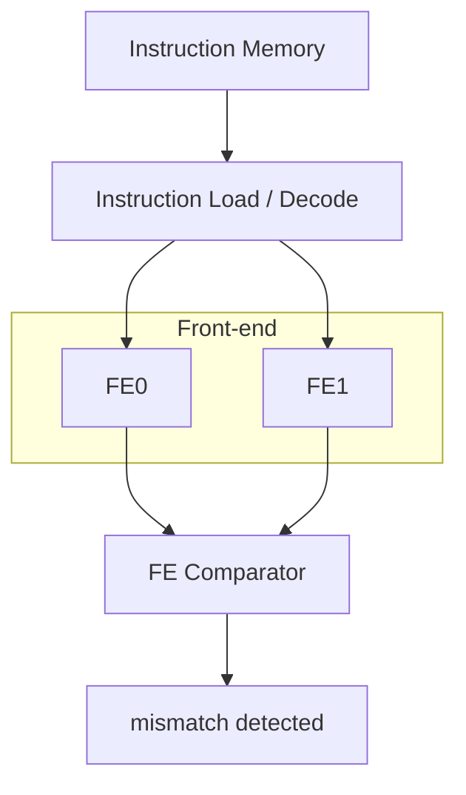
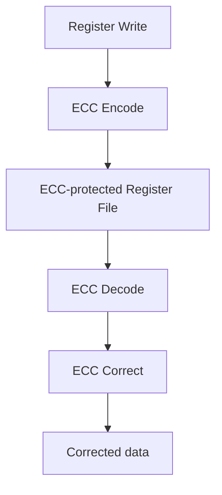

# Fault-Tolerant-TERME

A fault-tolerant RISC-V processor based on the TERME core, using selective hardware redundancy for fault detection, fault masking, and recovery at the RTL level.

## Overview

**Fault-Tolerant-TERME** is a fault-tolerant implementation of the TERME RISC-V processor that explores selective hardware redundancy as an alternative to duplicating or triplicating the complete processor.

The design combines:

* **Dual Modular Redundancy (DMR)** for fault detection in the front-end execution path
* **Triple Modular Redundancy (TMR)** for fault masking at the write-back boundary
* **Reset Point (RP) based recovery** for detected faults
* **SECDED ECC** for protection of the architectural register file
* RTL-level fault injection and simulation-based verification

The architecture follows the general protection philosophy of a safety-oriented RISC-V processor, while adapting the approach to the substantially shallower TERME pipeline. The protected design duplicates logic where disagreement can be detected before architectural state is affected, and triplicates logic where a corrupted result must be masked before reaching architectural state.

## Key Features

| Feature                  | Implementation                                            |
| ------------------------ | --------------------------------------------------------- |
| Processor                | TERME RISC-V                                              |
| Fault detection          | Dual Modular Redundancy (DMR)                             |
| Fault masking            | Triple Modular Redundancy (TMR)                           |
| Recovery                 | Reset Point based pipeline recovery                       |
| Register-file protection | Hamming SECDED                                            |
| Fault injection          | RTL simulation using hierarchical force/release           |
| Verification             | Embedded software stress tests + targeted fault injection |
| Implementation level     | Synthesizable RTL                                         |

## Architecture

The protected processor is organized around a selective-redundancy approach.

### DMR Front End

Two independent front-end execution paths operate on the same instruction stream:




The two paths independently perform decode, operand processing, ALU operations, branch resolution, and program-counter calculations. Their outputs are continuously compared to detect disagreement.

A mismatch causes the current execution to be flushed and execution to restart from a protected Reset Point.

## TMR Write-Back Protection

After the detection boundary, the design uses three backend instances. The majority voter performs bitwise two-out-of-three voting on the relevant backend results.

Consequently, a single faulty backend result can be masked without corrupting the value committed to architectural state.

## Reset Point Recovery

Detected front-end faults are recovered using a dedicated **Reset Point Register**.

The register stores the address of the next known-good instruction. When a fault is detected:

1. The current pipeline activity is flushed.
2. The faulting execution path is prevented from committing.
3. Both front-end paths redirect their program counters to the stored Reset Point.
4. Execution resumes from the previously verified instruction boundary.

This avoids the need to protect the program counter through every internal pipeline stage.

## Register File Protection

The architectural register file is protected independently using an extended Hamming **SECDED** code.

The current design uses a **39-bit codeword for 32-bit architectural data**, consisting of the data bits, Hamming parity bits, and an overall parity bit.

The protection flow is:


Single-bit errors can be corrected transparently, while multi-bit error conditions can be detected as uncorrectable depending on the observed syndrome and parity information.

## Fault-Tolerance Mechanisms

The project separates fault tolerance into three main functions:

### 1. Detection

DMR compares redundant execution paths and detects disagreements before corrupted execution can reach architectural state.

### 2. Masking

TMR and majority voting prevent a single faulty backend computation from propagating to the register file or data-memory interface.

### 3. Recovery

Detected DMR faults trigger a pipeline flush and restart from a protected Reset Point.

### 4. Register-File Protection

SECDED ECC independently protects stored architectural state.


## Project Structure

The repository is currently focused on the RTL implementation.

```text
Fault-Tolerant-TERME/
├── rtl/
│   ├── ...
│   ├── Pipeline/
│   ├── Pipe_Manager/
│   ├── TERME_Protected
│   └── ...
├── README.md
└── ...
```

The directory structure will be expanded as simulation files, test programs, scripts, and documentation are added.

## Simulation

> Simulation instructions will be added here.

The intended verification flow is:

```text
RTL
 │
 ▼
Compile
 │
 ▼
Run testbench
 │
 ├── Functional stress tests
 │
 └── Fault injection
        │
        ▼
   Check detection,
   recovery and masking
```

# Fault Injection Results

## 1. SEU Detection and Masking in a Fault-Tolerant RISC-V Core

## Overview

This section describes the SEU (single-event upset) fault-injection monitor added to the testbench of the fault-tolerant RISC-V core, and the results of single-bit injections on each protected stage.

The core combines three protection mechanisms:

| Mechanism | Scope | Monitored signal |
|-----------|-------|------------------|
| DMR (front-end) | Fetch / decode | `mismatch_fe` |
| DMR + TMR (memory/writeback) | MWB stage | `mismatch_mwb`, voted vs. per-lane results |
| ECC (SEC-DED, 39-bit codewords) | Register file read | `single_error{1,2}`, `double_error{1,2}`, `syndrome{1,2}` |

## Fault-Injection Infrastructure

The monitor is added at the end of the testbench and provides:

- **Event counters**: DMR_FE, DMR_MWB, TMR masked, ECC SEC, ECC DED, and data-memory write count.
- **Write trace**: every data-memory write (`index addr data wstrb`) is logged to `golden_writes.trace` (with `+GOLDEN_RUN`) or `faulty_writes.trace` (otherwise), so runs can be diffed for silent data corruption.
- **Fault injector**: a single-bit flip applied with `force`/`release` at a chosen cycle, bit, and duration.
- **End-of-run summary**: printed when the benchmark writes to the SIMEND address.

### Injection targets

| ID | Signal | Width | Protecting mechanism |
|----|--------|-------|----------------------|
| 1 | `PC_Out_dex0` | 32 | DMR (front-end) |
| 2 | `Instruction_dex0` | 32 | DMR (front-end) |
| 3 | `Alu_Result_al0` | 32 | DMR (MWB) |
| 4 | `Writeback_Result_mwb0` | 32 | TMR |
| 5 | `Writeback_Result_mwb2` | 32 | TMR |
| 6 | `Alu_Result_mwb2` | 32 | TMR |
| 7 | `read_codeword1` | 39 (ECC codeword) | ECC (SEC-DED) |

### Plusargs

| Plusarg | Default | Meaning |
|---------|---------|---------|
| `+GOLDEN_RUN` | off | Run without injection, write the golden trace |
| `+FI_TARGET=<id>` | 4 | Injection target (table above) |
| `+FI_CYCLE=<n>` | 1000 | Cycle of injection |
| `+FI_BIT=<n>` | 0 | Bit position to flip |
| `+FI_DUR=<n>` | 1 | Duration in cycles before release |

Example:

```
vsim ... +FI_TARGET=7 +FI_CYCLE=1200 +FI_BIT=12 +FI_DUR=1
```

## Results

**Workload:** CoreMark, 2K performance run, 1 iteration, `rv32ic_zicsr_zmmul`, `-O3`.
Each run injects a single-bit flip for 1 cycle on one target.

| Target | Signal | Mechanism | Triggered counter | Count | Outcome |
|--------|--------|-----------|-------------------|-------|---------|
| 1 | `PC_Out_dex0` | DMR (FE) | `DMR_FE_DETECTED` | 1 | Detected |
| 2 | `Instruction_dex0` | DMR (FE) | `DMR_FE_DETECTED` | 1 | Detected |
| 3 | `Alu_Result_al0` | DMR (MWB) | `DMR_MWB_DETECTED` | 1 | Detected |
| 4 | `Writeback_Result_mwb0` | TMR | `TMR_MASKED` | 1 | Masked by voter |
| 5 | `Writeback_Result_mwb2` | TMR | `TMR_MASKED` | 1 | Masked by voter |
| 6 | `Alu_Result_mwb2` | TMR | `TMR_MASKED` | 1 | Masked by voter |
| 7 | `read_codeword1` | ECC | `ECC_SEC_MASKED` | 1 | Corrected (single-bit) |

In every run, the mechanism that protects the injected stage was the one that responded, with exactly one event each. DMR flags a mismatch between the two copies, TMR outvotes the faulty lane, and ECC corrects a single-bit error using the syndrome.

### Target 7 detail (ECC)

**Configuration:** target 7 (`read_codeword1`), cycle 1200, bit 12, duration 1 cycle.

```
FI_INJ: C=1200 Inject Target=7 Bit=12 Dur=1
FI_MON: C=1200 ECC_SEC Syn1=12 Syn2=00
FI_INJ: C=1201 Fault Released
```

| Metric | Value |
|--------|-------|
| Exit code | 1 |
| Total cycles | 761,623 |
| Total data-memory writes | 18,057 |
| DMR_FE detected | 0 |
| DMR_MWB detected | 0 |
| TMR masked | 0 |
| **ECC SEC corrected** | **1** |
| ECC DED (uncorrectable) | 0 |

The flip was flagged in the same cycle it was injected (`Syn1=0x12`), and port 2 stayed clean (`Syn2=0x00`). No double-error was reported, which matches a single-bit upset.

## Notes

- The counters show which mechanism **responded** to the fault. They do not by themselves prove the program output stayed correct. To confirm that, compare each faulty run against the golden run:

```
  vsim ... +GOLDEN_RUN
  vsim ... +FI_TARGET=<id> +FI_CYCLE=<n> +FI_BIT=<n> +FI_DUR=1
  diff golden_writes.trace faulty_writes.trace
```

- The target 7 run exited with code 1 and CoreMark printed `Errors detected`. Run the golden run and check its exit code first: if it also exits with 1, the error comes from the benchmark setup and not from the injected fault.

